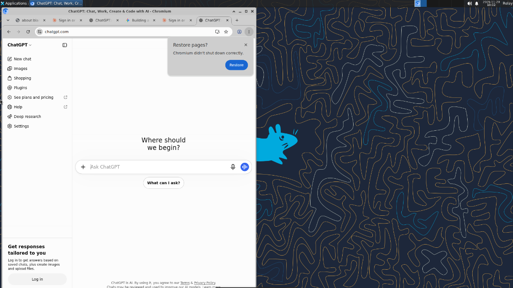

<div align="center">

# Relay

**Your AI team in one chat.**

ChatGPT · Claude · Gemini · Grok · Perplexity · Claude Code · Cursor · Codex · Copilot

Relay runs the real AI apps you already pay for inside a private Linux desktop, then has them **work on your task together**: they discuss it, correct each other, and a lead writes the final answer. No API keys.

[](https://github.com/manjeetsingh-satveer/Relay/releases/latest)
&nbsp;
[-f80000?style=for-the-badge&logo=oracle)](docs/cloud-oracle.md)
&nbsp;
[](LICENSE)
&nbsp;
[](CONTRIBUTING.md)

</div>


## Why Relay

- **Use your subscriptions, not API bills.** ChatGPT Plus, Claude Pro, Gemini, Grok and Perplexity already include the models. Relay drives the web apps you're signed into.
- **A team, not a tab.** In **Team mode** up to four AI apps take turns on your task, each seeing what the others said, then the lead writes one answer. You watch them talk in the chat.
- **Automatic hand-off.** If one app hits a usage cap, isn't signed in or stalls, Relay passes the work to the next one.
- **Coding agents built in.** Claude Code and the Cursor CLI run inside the same desktop; Codex, Gemini CLI and Copilot CLI are preinstalled.
- **On your PC or in the cloud.** Run it locally, or on a free Oracle Cloud server and use it from your phone with password + two-factor sign-in.
- **Private by design.** You sign in yourself. Relay never types or stores your AI passwords, and it never invents a reply when a tool fails.

## How it works



1. Relay starts a small **Ubuntu desktop**: a QEMU VM on Windows, or the server's own desktop in cloud mode.
2. The desktop has **Chromium**, an icon for each AI app, and the CLIs. You sign in to each once in the **Computer** tab.
3. You type in **chat**. Relay picks the agents (keyword rules today), uses **Playwright** to type into each real web app, waits for the answer and copies it back.
4. In Team mode each agent's reply is passed to the next as notes, then the lead writes the final answer.

| Mode | What happens |
| --- | --- |
| **Team** (default) | Up to 4 agents discuss in turn, and the lead writes the final answer |
| Single agent | The best ready agent answers, and Relay hands off to the next if it fails |
| Draft, review, revise | One agent drafts, a second reviews, and the first revises |

## Get started

### On Windows

**Requirements:** Windows 10/11 64-bit, [QEMU for Windows](https://qemu.weilnetz.de/w64/), **Windows Hypervisor Platform** turned on, 8 GB RAM or more (the VM needs about 1.6 GB free), and about 15 GB of disk.

1. Download the installer or the portable `.exe` from [Releases](https://github.com/manjeetsingh-satveer/Relay/releases/latest). SmartScreen may warn because the app isn't code-signed yet: **More info → Run anyway**.
2. Open Relay. The first run downloads Ubuntu (checked against its SHA256 list) and sets up the desktop, which takes about 10 minutes.
3. In **computer**, double-click each AI app icon and sign in. Use **Full screen** for a bigger view.
4. Go to **chat** and type into **General**.

### In the cloud (free, works from your phone)

Follow **[docs/cloud-oracle.md](docs/cloud-oracle.md)**: create a free Oracle Cloud Ampere server, run one setup command, then open Relay over Tailscale on your laptop and phone. Cloud mode needs a password plus an authenticator code, with recovery codes, and nothing is exposed to the public internet.

## Supported tools

| Tool | How Relay uses it | You need |
| --- | --- | --- |
| ChatGPT, Claude, Gemini, Grok, Perplexity | Their web app in the desktop's Chromium | To sign in once |
| Claude Code, Cursor CLI | The CLI inside the desktop | `claude` / `cursor-agent login` once in the terminal |
| Codex, Gemini CLI, GitHub Copilot CLI | Preinstalled for you to use in the terminal | To log in once |
| Grok Bot | Desktop app, installed from the **Install Grok Bot** icon | Your Grok Bot account |
| OpenAI, Anthropic, Gemini, Perplexity, xAI APIs | Optional, off by default | An API key, if you turn it on |

> Automating a consumer website can conflict with that service's terms. Use Relay with your own accounts, at your own discretion. [docs/integrations.md](docs/integrations.md) links each provider's terms.

## Roadmap

Help is welcome on all of these. Each one is a good place to start:

- [ ] **An AI router**: a model that splits a task and picks agents, instead of keyword rules
- [ ] **Run team agents in parallel** on machines with enough memory (the cloud server has room)
- [ ] **Keep selectors fresh** for every site, with a nightly check that signs in and sends a test prompt
- [ ] **Native mobile app** (today: install as a web app on your home screen)
- [ ] **macOS and Linux desktop builds** (QEMU with HVF/KVM)
- [ ] **Lighter desktop image** for 8 GB laptops
- [ ] **Code-signed Windows installer**
- [ ] **More agents**: DeepSeek, Mistral Le Chat, Microsoft Copilot

## Contributing

Relay is MIT-licensed and built in the open, so **every kind of help counts**: fixing a selector when a site changes, testing on your hardware, docs, design, or new features.

1. Read **[CONTRIBUTING.md](CONTRIBUTING.md)**. It takes 5 minutes to get a dev build running.
2. Pick an issue labelled [**good first issue**](https://github.com/manjeetsingh-satveer/Relay/issues?q=is%3Aissue+is%3Aopen+label%3A%22good+first+issue%22) or [**help wanted**](https://github.com/manjeetsingh-satveer/Relay/issues?q=is%3Aissue+is%3Aopen+label%3A%22help+wanted%22).
3. Say hi in the issue before you start so nobody duplicates work, then open a pull request.

The quickest win is a site that broke. Every selector is in [`src/browser/sites.ts`](src/browser/sites.ts), and a one-line fix helps every user.

## Build from source

```bash
git clone https://github.com/manjeetsingh-satveer/Relay.git
cd Relay
npm ci
npm test
npm run dev          # web UI at http://127.0.0.1:43123
npm run dist:win     # Windows installer + portable exe in release/
```

More: [architecture](docs/architecture.md) · [VM details](docs/vm.md) · [cloud setup](docs/cloud-oracle.md) · [troubleshooting](docs/troubleshooting.md)

## Security

The local API listens only on `127.0.0.1`. Cloud mode adds password + TOTP two-factor sign-in, single-use recovery codes, HttpOnly session cookies, lockout after repeated failures, and Tailscale-only access. Report vulnerabilities privately, as described in [SECURITY.md](SECURITY.md).

## License

MIT © 2026 Manjeet Singh. Third-party programs (QEMU, Ubuntu, Chromium) are not included. See [docs/third-party.md](docs/third-party.md).

---

If Relay saves you a few browser tabs, **give it a ⭐**. It helps other people find the project.
