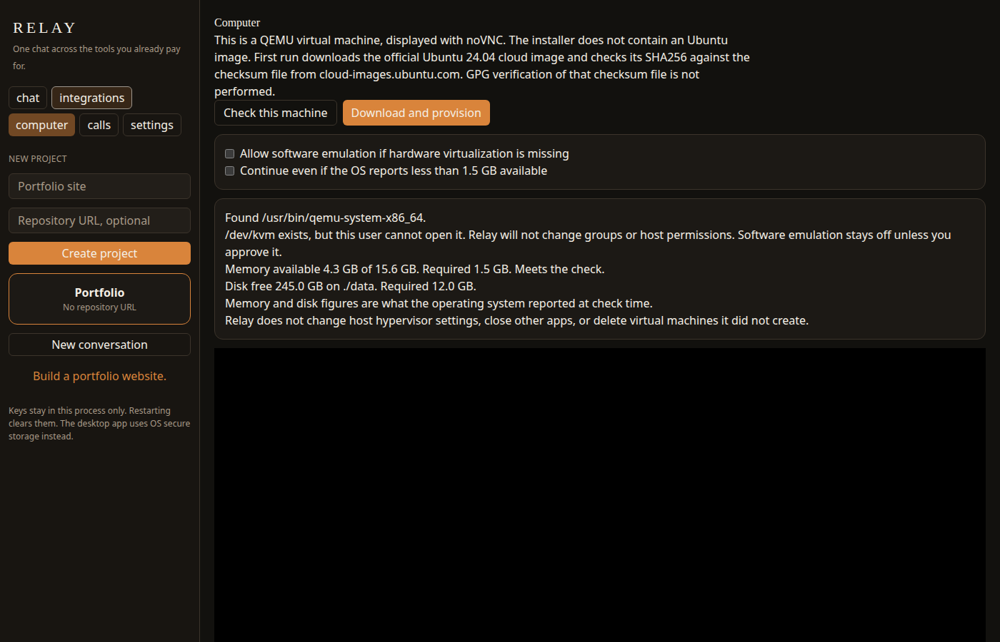

# Relay

One desktop chat that sends work to the AI tools you already use, then brings the reply and the files back. It can also open a real Linux machine in a Computer tab.

You connect each account once. Relay does not pretend a tool is connected, and it does not answer as if it were the model when no provider is ready.

## Status

This is version 0.1.0.

- Chat, projects, follow-ups, cancellation, retries, and files returned by a provider are implemented.
- Draft, then an independent review, then one revision, with turn, time, and call limits.
- OpenAI, Anthropic, Gemini, Perplexity, the xAI API, Cursor cloud agents, and Claude Code have adapters. They stay idle until you store a key or install the CLI.
- Nace Drex can choose the agent. Drex does not write the chat reply, and it is not a virtual machine.
- Grok Bot chat and Grok Bot phone calls are unsupported. The docs describe those features inside the Grok Bot apps, not as an API.
- The Computer tab drives QEMU and noVNC. The app download does not contain the Ubuntu image.

No provider call was completed in the environment that produced this tree, because no API keys were available. `npm test` proves the local behavior and the request shapes. Live tests are skipped until you export keys. See [docs/credentials.md](docs/credentials.md).


That capture is the real chat, on a machine with no API keys. The task failed. Relay did not invent a reply.



That capture is the real Computer tab on the build machine. It is not a booted desktop. A recording of a running guest does not exist yet.


The SVG is a placeholder for a future capture of a booted guest or a finished agent task. It is not a demo.

## Quick start

Requires Node.js 22 or newer.

```bash
npm ci
npm test
npm run dev
```

Open http://127.0.0.1:43123.

Create a project, store one API key under Integrations, and send a message. If you send before that, the task fails and the transcript does not invent an assistant reply.

Keys in `npm run dev` stay in memory. Quit the process and they are gone.

## Desktop app

```bash
npm run build
npm run desktop
```

The Electron build stores keys with the OS secure store when encryption is available (DPAPI on Windows).

A Windows installer and a portable executable are built on a Windows GitHub Actions runner. See [.github/workflows/ci.yml](.github/workflows/ci.yml). This Linux checkout does not produce the `.exe`. The workflow uploads `release/*.exe`. Those files are the app only.

## The Linux machine

Open Computer, run the check, then download. Relay fetches the official Ubuntu 24.04 cloud image and verifies its SHA256. It does not verify the checksum file's GPG signature. QEMU is not bundled. Details are in [docs/vm.md](docs/vm.md).

## Integrations

The table in the app is the same registry as [docs/integrations.md](docs/integrations.md). Short version:

| | Chat or task | Needs |
| --- | --- | --- |
| OpenAI API | Supported | API key, separate from ChatGPT Plus |
| Anthropic API | Supported | API key, separate from claude.ai |
| Gemini API | Supported | API key, separate from the Gemini app |
| Perplexity Agent API | Supported | API key. Comet is unsupported |
| xAI API | Supported | API key and a model id you set. This is not Grok Bot |
| Cursor cloud agents | Supported | API key. Add a repository URL for repo work |
| Claude Code | Supported if `claude` is installed | A real run to prove the login |
| Nace Drex | Routing only | API key |
| Grok Bot | Unsupported, including phone calls | No documented API for this |

## Develop

[docs/architecture.md](docs/architecture.md) · [CONTRIBUTING.md](CONTRIBUTING.md) · [docs/troubleshooting.md](docs/troubleshooting.md) · [docs/good-first-issues.md](docs/good-first-issues.md)

## Security

[SECURITY.md](SECURITY.md). The API listens on 127.0.0.1. Do not commit keys, chats, browser profiles, or VM disks.

## License

MIT. Copyright 2026 Manjeet Singh. Third-party programs are not included. See [docs/third-party.md](docs/third-party.md).

## GitHub

Name, description, and topic suggestions for the public repository are in [docs/github.md](docs/github.md). There is no download counter and no CI badge in this README, because those would point at a workflow that has not run yet.
