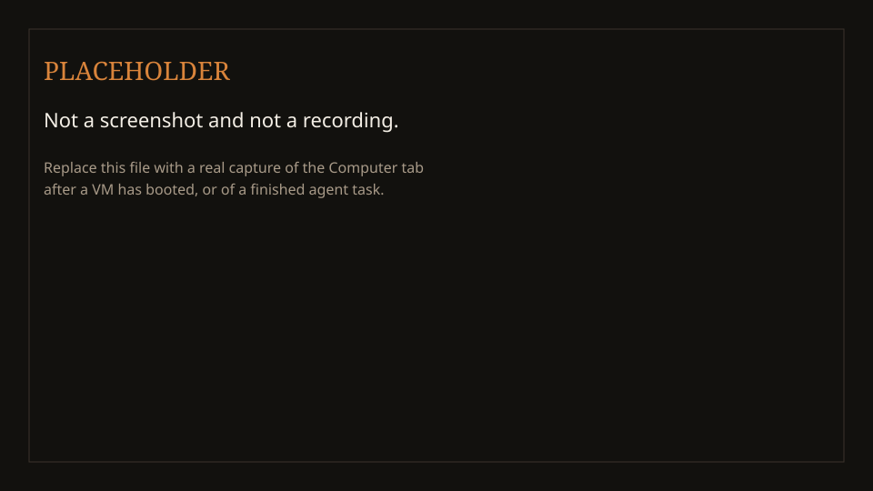

# Relay

One desktop chat that drives the AI websites you are already signed into. The browser runs inside Relay's Linux machine. You sign in there yourself, including MFA or a human check. Relay types the prompt, waits for the page to finish, and copies the answer back with a label such as "via Claude web app".

API keys are optional and off unless you turn them on. Relay does not type or store your website password.

## Status

This is version 0.1.0.

- The default path is the website in the VM: Claude, ChatGPT, Gemini, Perplexity, and the Grok website. Selectors for each site are in `src/browser/sites.ts`.
- Claude Code and the Cursor CLI run inside that same VM, using the login on that machine.
- API adapters remain available after you enable them in Settings.
- Drex can still choose an agent when you store a Nace key. Without that key, routing is local rules or the agent you pick.
- Grok Bot chat and Grok Bot phone calls are unsupported.
- The Computer tab is QEMU plus noVNC. The download does not contain Ubuntu or a browser profile.

The website flow was tested against local fixture pages in Chrome, not against live claude.ai or chatgpt.com. A logged-in VM desktop was not booted here. See [docs/integrations.md](docs/integrations.md).


That capture is the real chat, on a machine with no API keys. The task failed. Relay did not invent a reply.


That capture is the real Computer tab on the build machine. It is not a booted desktop. A recording of a running guest does not exist yet.



The SVG is a placeholder for a future capture of a booted guest or a finished agent task. It is not a demo.

## Quick start

Repository: https://github.com/manjeetsingh-satveer/Relay

Requires Node.js 22 or newer.

```bash
git clone https://github.com/manjeetsingh-satveer/Relay.git
cd Relay
npm ci
npm test
npm run dev
```

Open http://127.0.0.1:43123.

Create a project. To use a website, start the VM from Computer and sign in on that desktop. Sending before the VM browser is up fails, and the transcript does not invent an assistant reply.

Dev mode keeps optional API keys in memory. The Electron app can store those keys with the OS when you enable the API path. Website passwords are never stored.

## Desktop app

```bash
npm run build
npm run desktop
```

The Electron build stores keys with the OS secure store when encryption is available (DPAPI on Windows).

A Windows installer and a portable executable are built on a Windows GitHub Actions runner. See [.github/workflows/ci.yml](.github/workflows/ci.yml). This Linux checkout does not produce the `.exe`. The workflow uploads `release/*.exe`. Those files are the app only.

## The Linux machine

Open Computer, run the check, then download. Relay fetches the official Ubuntu 24.04 cloud image and verifies its SHA256. It does not verify the checksum file's GPG signature. QEMU is not bundled. Details are in [docs/vm.md](docs/vm.md).

## Integrations

The table in the app is the same registry as [docs/integrations.md](docs/integrations.md). Short version:

| | Default path | Needs |
| --- | --- | --- |
| Claude, ChatGPT, Gemini, Perplexity, Grok website | The site in the VM browser | You sign in on the Computer tab. No API key |
| Claude Code, Cursor CLI | The CLI inside the VM | That binary, and the login you create there |
| OpenAI, Anthropic, Gemini, Perplexity, xAI, Cursor APIs | Off until Settings enables API keys | An API key, which a website login does not include |
| Nace Drex | Optional router | API key. Local rules work without it |
| Grok Bot, including phone calls | Unsupported | No documented API |
| Comet | Unsupported | No documented task API. perplexity.ai is the web path |

Driving a consumer website can conflict with that service's terms. The matrix in [docs/integrations.md](docs/integrations.md) links each terms page.

## Develop

[docs/architecture.md](docs/architecture.md) · [CONTRIBUTING.md](CONTRIBUTING.md) · [docs/troubleshooting.md](docs/troubleshooting.md) · [docs/good-first-issues.md](docs/good-first-issues.md)

## Security

[SECURITY.md](SECURITY.md). The API listens on 127.0.0.1. Do not commit keys, chats, browser profiles, or VM disks.

## License

MIT. Copyright 2026 Manjeet Singh. Third-party programs are not included. See [docs/third-party.md](docs/third-party.md).

## GitHub

Issues and pull requests: https://github.com/manjeetsingh-satveer/Relay/issues

Topic suggestions are in [docs/github.md](docs/github.md). This README has no download counter and no CI badge. The Actions workflow has not run on GitHub yet, so a badge would be a broken image.
