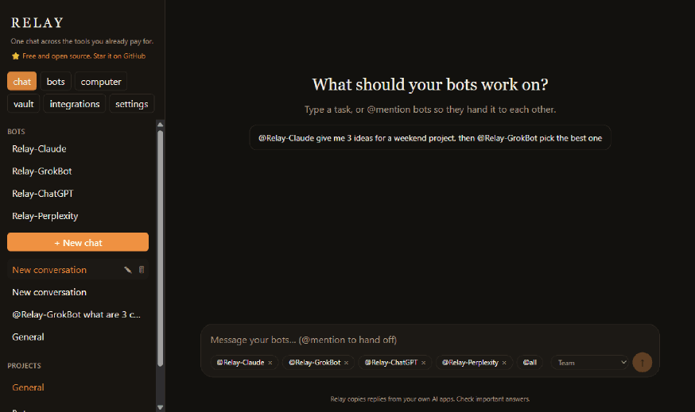
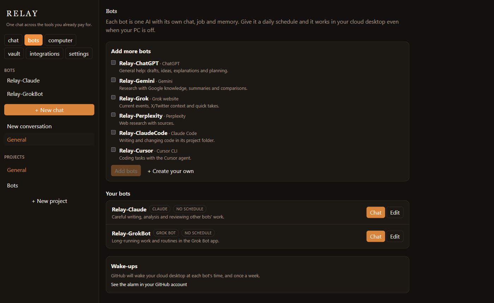

<div align="center">

# Relay

**Your AI team in one chat, running in the cloud.**

ChatGPT · Claude · Gemini · Grok · Grok Bot · Perplexity · Claude Code · Cursor · Codex · Copilot

Relay runs the real AI apps you already pay for inside **your own private cloud desktop**, turns each one into a **bot** with its own chat, job and schedule, and lets you **@mention** them so they work on your task together. No API keys, nothing running on your PC.

[](https://github.com/manjeetsingh-satveer/Relay/releases/latest)
&nbsp;
[](https://github.com/manjeetsingh-satveer/Relay/releases)
&nbsp;
[](https://github.com/manjeetsingh-satveer/Relay/stargazers)
&nbsp;
[-24292f?style=for-the-badge&logo=github)](https://codespaces.new/manjeetsingh-satveer/Relay?quickstart=1)
&nbsp;
[](https://huggingface.co/spaces/msingh21satveer/Relay)
&nbsp;
[](LICENSE)
&nbsp;
[](CONTRIBUTING.md)

</div>



<sub>Real run, not mocked: Grok Bot and Claude answering through their own apps in a Codespace. The waiting is sped up.</sub>

## Why Relay

- **Use your subscriptions, not API bills.** ChatGPT Plus, Claude Pro, Gemini, Grok and Perplexity already include the models. Relay drives the web apps you're signed into.
- **Bots, like Grok Bot.** Pick from ChatGPT, Claude, Gemini, Grok, Grok Bot, Perplexity, Claude Code and Cursor, or create your own. Each bot has its own chat, job and memory.
- **@mention to hand off work.** Type `@Relay-GrokBot research this, then @Relay-Claude pick the best` in any chat. Each bot works in turn, sees what the others said, and answers back in the same chat. `@all` asks everyone.
- **Scheduled bots that run while your PC is off.** A GitHub Action in your own account wakes your cloud desktop at each bot's time.
- **A team, not a tab.** In **Team mode** up to four AI apps take turns on your task, each seeing what the others said, then the lead writes one answer. You watch them talk in the chat.
- **Automatic hand-off.** If one app hits a usage cap, isn't signed in or stalls, Relay passes the work to the next one.
- **Coding agents built in.** Claude Code and the Cursor CLI run inside the same desktop; Codex, Gemini CLI and Copilot CLI are preinstalled.
- **All in the cloud, free.** Your desktop runs in your own GitHub Codespace (or a free Oracle server), not on your computer, so it works on any PC or phone and doesn't use your RAM.
- **Private by design.** You sign in yourself. Relay never types or stores your passwords: they live in Bitwarden in your desktop. Relay's **Vault** only keeps addresses and notes you choose to reuse, and it never invents a reply when a tool fails.

## How it works




1. Relay runs a small **Linux desktop in the cloud**: your own GitHub Codespace (or your own server).
2. The desktop has **Chromium**, an icon for each AI app, and the CLIs. You sign in to each once in the **Computer** tab.
3. You type in **chat** or a **bot's chat**. Relay uses **Playwright** to type into each real web app (or the Grok Bot desktop app), waits for the answer and copies it back.
4. **@mentions** and **Team mode** pass each agent's reply to the next as notes, so they build on each other.
5. Scheduled bots run inside the Codespace. The private **relay-alarm** repository in your GitHub account wakes it on time, and once a week so GitHub never deletes it.

| Mode | What happens |
| --- | --- |
| **@mention bots** | The bots you name work in turn in their own chats, and each reply comes back to your chat |
| **Team** (default) | Up to 4 agents discuss in turn, and the lead writes the final answer |
| Single agent | The best ready agent answers, and Relay hands off to the next if it fails |
| Draft, review, revise | One agent drafts, a second reviews, and the first revises |

## Get started

### On Windows (recommended)

1. Download the installer or the portable `.exe` from [Releases](https://github.com/manjeetsingh-satveer/Relay/releases/latest). SmartScreen may warn because the app isn't code-signed yet: **More info → Run anyway**.
2. Open Relay and click **Continue with GitHub**, then approve the code in your browser.
3. Relay creates your own private Codespace in your GitHub account (about 10 minutes the first time, then about a minute to wake), using GitHub's free monthly hours. No card.
4. Choose a password and turn on two-factor sign-in.
5. **Pick your bots** (or create your own), then in **computer** sign in to each AI app once.
6. Go to **chat** and type into **General**, or @mention your bots. Open the same desktop on your phone and carry on where you left off.

To let scheduled bots run while your PC is off, approve **repo** and **workflow** access when Relay asks. Relay then creates the private `relay-alarm` repository in your account. Skip it and everything else still works.

### In GitHub Codespaces (free, no card, one click)

Click **Open in Codespaces** above. Relay builds itself in your own private Codespace (about 10 minutes the first time), then you open it from your PC or phone with password + two-factor sign-in. See [docs/codespaces.md](docs/codespaces.md).

### Optional: your own always-on server instead of Codespaces

Relay normally runs in GitHub Codespaces (above). If you'd rather have a server that never sleeps, follow **[docs/cloud-oracle.md](docs/cloud-oracle.md)**: create a free Oracle Cloud Ampere server, run one setup command, then open Relay over Tailscale on your laptop and phone. Cloud mode needs a password plus an authenticator code, with recovery codes, and nothing is exposed to the public internet.

## Supported tools

| Tool | How Relay uses it | You need |
| --- | --- | --- |
| ChatGPT, Claude, Gemini, Grok, Perplexity | Their web app in the desktop's Chromium | To sign in once |
| Claude Code, Cursor CLI | The CLI inside the desktop | `claude` / `cursor-agent login` once in the terminal |
| Codex, Gemini CLI, GitHub Copilot CLI | Preinstalled for you to use in the terminal | To log in once |
| Grok Bot | The Grok Bot desktop app, installed in your desktop automatically | To sign in once in its window |
| Bitwarden | Password manager in the desktop's Chromium, for passwords and cards (you autofill, Relay never sees them) | A free Bitwarden account |
| OpenAI, Anthropic, Gemini, Perplexity, xAI APIs | Optional, off by default | An API key, if you turn it on |

> Automating a consumer website can conflict with that service's terms. Use Relay with your own accounts, at your own discretion. [docs/integrations.md](docs/integrations.md) links each provider's terms.

## Roadmap

Help is welcome on all of these. Each one is a good place to start:

- [ ] **An AI router**: a model that splits a task and picks agents, instead of keyword rules
- [ ] **Run team agents in parallel** on machines with enough memory (the cloud server has room)
- [ ] **Keep selectors fresh** for every site, with a nightly check that signs in and sends a test prompt
- [ ] **Native mobile app** (today: install as a web app on your home screen)
- [ ] **macOS and Linux app builds** (the app is a thin client, so this is mostly packaging)
- [ ] **Keep the Codespace awake while a long task runs**
- [ ] **Bots that @mention each other** with a safe limit on hand-offs
- [ ] **A separate workspace per bot** (own Linux user, files and browser profile)
- [ ] **Push notifications** when a scheduled bot finishes
- [ ] **Code-signed Windows installer**
- [ ] **More agents**: DeepSeek, Mistral Le Chat, Microsoft Copilot

## Contributing

Relay is MIT-licensed and built in the open, so **every kind of help counts**: fixing a selector when a site changes, testing on your hardware, docs, design, or new features.

1. Read **[CONTRIBUTING.md](CONTRIBUTING.md)**. It takes 5 minutes to get a dev build running.
2. Pick an issue labelled [**good first issue**](https://github.com/manjeetsingh-satveer/Relay/issues?q=is%3Aissue+is%3Aopen+label%3A%22good+first+issue%22) or [**help wanted**](https://github.com/manjeetsingh-satveer/Relay/issues?q=is%3Aissue+is%3Aopen+label%3A%22help+wanted%22).
3. Say hi in the issue before you start so nobody duplicates work, then open a pull request.

The quickest win is a site that broke. Every selector is in [`src/browser/sites.ts`](src/browser/sites.ts), and a one-line fix helps every user.

## Build from source

```bash
git clone https://github.com/manjeetsingh-satveer/Relay.git
cd Relay
npm ci
npm test
npm run dev          # web UI at http://127.0.0.1:43123
npm run dist:win     # Windows installer + portable exe in release/
```

More: [architecture](docs/architecture.md) · [Codespaces](docs/codespaces.md) · [cloud setup](docs/cloud-oracle.md) · [troubleshooting](docs/troubleshooting.md)

## Security

The local API listens only on `127.0.0.1`. Cloud mode adds password + TOTP two-factor sign-in, single-use recovery codes, HttpOnly session cookies, lockout after repeated failures, and Tailscale-only access. Report vulnerabilities privately, as described in [SECURITY.md](SECURITY.md).

## License

MIT © 2026 Manjeet Singh. Third-party programs (Debian, Chromium) run in your own Codespace and are not included. See [docs/third-party.md](docs/third-party.md).

---

If Relay saves you a few browser tabs, **give it a ⭐**. It helps other people find the project.
