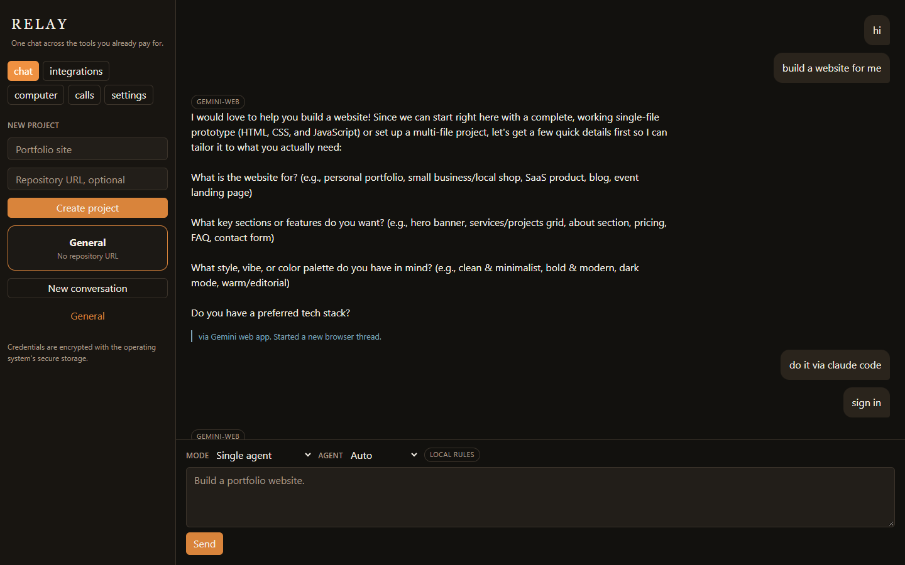

<div align="center">

# Relay

**One chat for the AI tools you already pay for.**

ChatGPT · Claude · Gemini · Grok · Perplexity · Claude Code · Cursor

No API keys. Relay drives the real web apps inside a private Linux VM on your PC and brings the answers back to one chat.

[](https://github.com/manjeetsingh-satveer/Relay/releases/latest)
&nbsp;
[](LICENSE)

</div>



*A real answer from Gemini's web app, sent from Relay's chat. Every reply is labelled with the tool that wrote it.*

## Why Relay

- **Use your subscriptions, not API bills.** ChatGPT Plus, Claude Pro, Gemini, Grok, and Perplexity already include the models. Relay uses the web apps you're signed into, so there are no keys to buy or paste.
- **One chat, many models.** Type once. Relay picks the right tool: coding goes to Claude Code or Cursor, research to Perplexity, and everything else to Claude, ChatGPT, or Gemini. You can also pick one yourself.
- **Automatic escalation.** If a model hits a usage cap, isn't signed in, or times out, Relay hands the same task to the next ready model instead of giving up.
- **Draft → review → revise.** Collaborative mode has one model draft, a second review, and the first revise.
- **Private by design.** Everything runs on your PC in an isolated Ubuntu VM. You sign in yourself. Relay never types or stores your passwords, and it never invents a reply when a tool fails.

## How it works


1. Relay starts a small **Ubuntu 24.04 VM** with QEMU (hardware-accelerated with Windows Hypervisor Platform).
2. The VM opens straight into a desktop with **Chromium**, app icons for each AI site, and the **Claude Code, Cursor, Gemini, Codex, and GitHub Copilot CLIs** preinstalled.
3. You sign in to each site once, in the **Computer** tab.
4. When you send a message, Relay uses **Playwright** to type it into the right site, waits for the answer to finish, and copies it back into your chat.

## Get started

**Requirements**

- Windows 10 or 11, 64-bit
- [QEMU for Windows](https://qemu.weilnetz.de/w64/) installed (Relay does not bundle it)
- **Windows Hypervisor Platform** turned on (*Turn Windows features on or off*)
- At least **8 GB RAM** (the VM needs about 1.6 GB free) and about 15 GB of disk

**Install**

1. Download `Relay-Setup-x.y.z.exe` (installer) or the portable `.exe` from [Releases](https://github.com/manjeetsingh-satveer/Relay/releases/latest).
2. Windows SmartScreen may warn you because the app isn't code-signed yet. Click **More info → Run anyway**.
3. Open Relay. The first launch downloads the official Ubuntu cloud image (checked against Ubuntu's SHA256 list) and sets up the VM. This takes about 10 minutes.
4. In the **Computer** tab, double-click each AI app icon on the VM desktop and sign in. For the CLIs, open the VM terminal and run `claude` or `cursor-agent` once.
5. Go to **chat** and type into the **General** conversation.

## Supported tools

| Tool | How Relay uses it | You need |
| --- | --- | --- |
| ChatGPT, Claude, Gemini, Grok, Perplexity | Their web app in the VM's Chromium | To sign in once in the VM |
| Claude Code, Cursor CLI | The CLI inside the VM | To log in once in the VM terminal |
| Gemini CLI, Codex CLI, GitHub Copilot CLI | Preinstalled in the VM for you to use | To log in once in the VM terminal |
| OpenAI, Anthropic, Gemini, Perplexity, xAI APIs | Optional, off by default | An API key, if you turn it on in Settings |

Each site's selectors are in [`src/browser/sites.ts`](src/browser/sites.ts). Details are in [docs/integrations.md](docs/integrations.md).

> **Note:** Automating a consumer website can conflict with that service's terms. You use Relay with your own accounts, at your own discretion. [docs/integrations.md](docs/integrations.md) links each provider's terms.

## Build from source

Requires Node.js 22+.

```bash
git clone https://github.com/manjeetsingh-satveer/Relay.git
cd Relay
npm ci
npm test
npm run dist:win     # builds release/Relay-Setup-*.exe and a portable .exe
```

Use `npm run dev` for the web UI with a local API at http://127.0.0.1:43123, or `npm run build && npm run desktop` for the Electron app.

More: [architecture](docs/architecture.md) · [VM details](docs/vm.md) · [troubleshooting](docs/troubleshooting.md) · [contributing](CONTRIBUTING.md) · [good first issues](docs/good-first-issues.md)

## Status

Relay is **v0.1, early but working**. Gemini's web app has answered end to end, and the VM, desktop, and CLIs are installed automatically. Known gaps:

- Site selectors break when providers change their pages. Fixes to `src/browser/sites.ts` are very welcome.
- The Windows build isn't code-signed yet.
- Low-RAM PCs (under 8 GB) may struggle to run the VM.
- Grok Bot phone calls aren't supported (there's no documented API).

## Security

Relay's API listens only on `127.0.0.1`. Optional API keys are encrypted with Windows DPAPI. Website passwords are never typed or stored by Relay. See [SECURITY.md](SECURITY.md).

## License

MIT © 2026 Manjeet Singh. Third-party programs (QEMU, Ubuntu, Chromium) are not included. See [docs/third-party.md](docs/third-party.md).

---

If Relay saves you a few browser tabs, **give it a ⭐** to help others find it.
